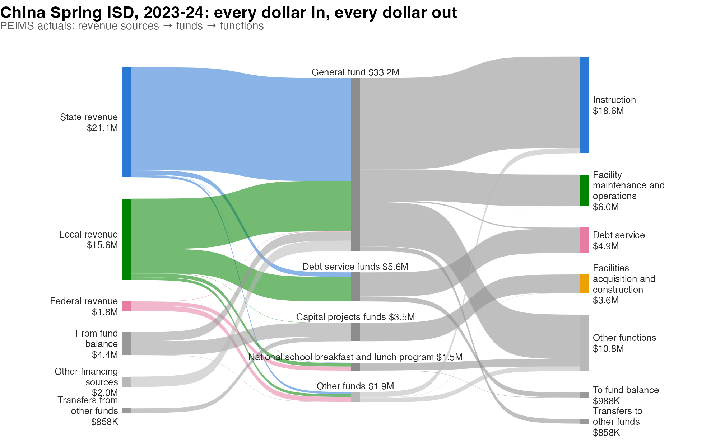
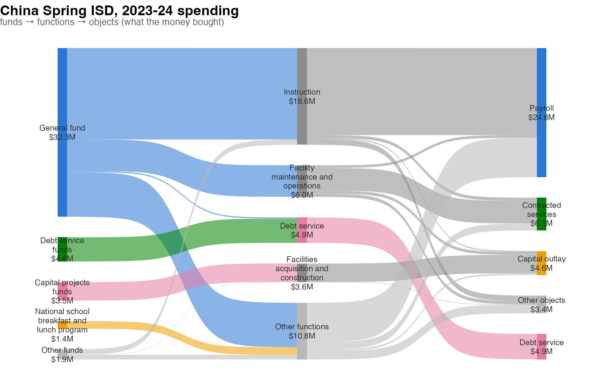
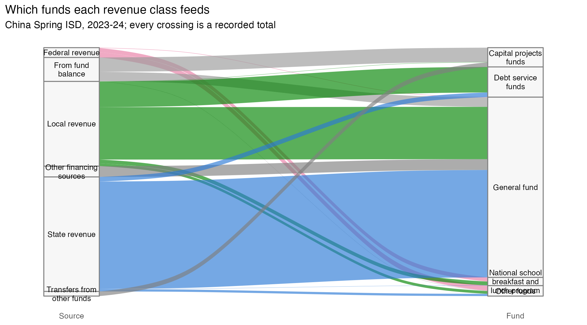

# Money-flow diagrams from PEIMS finance data

Financial-media flow diagrams – the “how they make money” income
statements popularized by [App Economy
Insights](https://www.appeconomyinsights.com) – read a company’s quarter
as a river: revenue segments merge on the left, costs and profit split
off to the right. A Texas school district’s year can be drawn exactly
the same way from the PEIMS financial data that
[`txs_get_peims_finance()`](https://dkahle.github.io/txschools/reference/txs_get_peims_finance.md)
returns, and this vignette is a tour of how: first the *concepts* (what
a flow diagram claims, and what the accounting actually supports), then
the built-in helpers, then the same chart built with other tools.

Throughout we use China Spring ISD’s 2023-24 actuals. Chunks that
download data or draw charts only run when the vignette is built with
`TXS_LIVE=true`; the code is complete either way.

\
[`library`](https://rdrr.io/r/base/library.html)`(``txschools``)`\
[`library`](https://rdrr.io/r/base/library.html)`(`[`dplyr`](https://dplyr.tidyverse.org)`)`\
\
`cs`` ``<-`` `[`txs_get_peims_finance`](https://dkahle.github.io/txschools/reference/txs_get_peims_finance.md)`(``2024``, ``"actual"``, ``"district"``, verbose ``=`` ``FALSE``)`` ``|>`\
`  `[`filter`](https://dplyr.tidyverse.org/reference/filter.html)`(``district`` ``==`` ``"161920"``)`

## The concept: what a flow diagram claims

A Sankey-style chart makes two kinds of statements. **Node sizes** say
“this much money was in this category” – those are ordinary totals, and
PEIMS supports them richly, because every row carries the full chart of
accounts:

- **source class** – local (object 5700s), state (5800s), federal
  (5900s) revenue;
- **fund** – the account the money sits in (general fund, food service,
  Title I, debt service, …);
- **function** – what spending was *for* (instruction, school
  leadership, …);
- **object** – what was *bought* (payroll, contracted services,
  supplies, capital outlay, …);
- **program intent** – who it was intended to serve (basic services,
  special education, …).

**Ribbons**, though, say something stronger: “*this* money became *that*
money.” That claim is only honest where the accounting actually records
the join. Money is fungible – TEA does not record which revenue dollar
paid which invoice – so a ribbon drawn straight from “State revenue” to
“Instruction” would be an invention.

What *is* recorded, on both sides, is the **fund**. A revenue row says
which fund a dollar entered; an expenditure row says which fund it left,
along with its function, object, and program intent. Funds are also
legally meaningful: grant funds are restricted, so a federal dollar
arriving in the Title I fund can only leave as Title I spending. That
makes `source -> fund -> function` a chain of genuine recorded totals,
and it is why
[`txs_peims_flow()`](https://dkahle.github.io/txschools/reference/txs_peims_flow.md)
refuses to put `"source"` next to anything but `"fund"`.

Two wrinkles remain. First, money also enters and leaves funds outside
ordinary revenue and spending: PEIMS records **inter-fund transfers**
(objects 7915 in, 8911 out) and **other financing sources and uses**
(bond, loan, and lease proceeds, asset sales; the remaining
7900s/8900s). The flow builder draws these through their own nodes –
transfers as half-edges via “Transfers from/to other funds”, because TEA
records each end on its own fund but not the fund-to-fund pairing.
Second, funds rarely break even in a year: a district draws down bond
proceeds it banked earlier, or tucks away a surplus. What is left after
revenues, spending, transfers, and financing is each fund’s true change
in its pot, reconciled with explicit **“From fund balance”** and **“To
fund balance”** nodes – so both sides of every fund sum identically and
the chart accounts for every dollar.

## The built-in pipeline

[`txs_peims_flow()`](https://dkahle.github.io/txschools/reference/txs_peims_flow.md)
turns a pull into a stage-to-stage edge list;
[`txs_plot_peims_flow()`](https://dkahle.github.io/txschools/reference/txs_plot_peims_flow.md)
draws it with [ggsankey](https://github.com/davidsjoberg/ggsankey)
(GitHub-only: `remotes::install_github("davidsjoberg/ggsankey")`) and
returns a regular ggplot.

\
`flows`` ``<-`` `[`txs_peims_flow`](https://dkahle.github.io/txschools/reference/txs_peims_flow.md)`(``cs``, lump ``=`` ``4``)`\
`flows`\
`#> ``# A tibble: 31 × 5`\
`#>    from_axis from                       to_axis to                        amount`\
`#>    ``<chr>``     ``<chr>``                      ``<chr>``   ``<chr>``                      ``<dbl>`\
`#> `` 1`` source    State revenue              fund    General fund              1.98``e``7`\
`#> `` 2`` source    Local revenue              fund    General fund              9.65``e``6`\
`#> `` 3`` source    Local revenue              fund    Debt service funds        4.70``e``6`\
`#> `` 4`` source    From fund balance          fund    Capital projects funds    2.64``e``6`\
`#> `` 5`` source    Other financing sources    fund    General fund              1.98``e``6`\
`#> `` 6`` source    From fund balance          fund    General fund              1.72``e``6`\
`#> `` 7`` source    Federal revenue            fund    Other funds               9.60``e``5`\
`#> `` 8`` source    State revenue              fund    Debt service funds        8.59``e``5`\
`#> `` 9`` source    Transfers from other funds fund    Capital projects funds    8.58``e``5`\
`#> ``10`` source    Federal revenue            fund    National school breakfas… 7.73``e``5`\
`#> ``# ℹ 21 more rows`

The edge list is the whole interface: `from_axis`/`from` and
`to_axis`/`to` name the stages and nodes, `amount` is dollars. Note the
fund-balance rows doing the reconciliation.

\
[`library`](https://rdrr.io/r/base/library.html)`(`[`ggplot2`](https://ggplot2.tidyverse.org)`)`\
\
[`txs_plot_peims_flow`](https://dkahle.github.io/txschools/reference/txs_plot_peims_flow.md)`(``flows``)`` ``+`\
`  `[`labs`](https://ggplot2.tidyverse.org/reference/labs.html)`(`\
`    title ``=`` ``"China Spring ISD, 2023-24: every dollar in, every dollar out"``,`\
`    subtitle ``=`` ``"PEIMS actuals: revenue sources → funds → functions"`\
`  ``)`` ``+`\
`  `[`theme`](https://ggplot2.tidyverse.org/reference/theme.html)`(``plot.title ``=`` `[`element_text`](https://ggplot2.tidyverse.org/reference/element.html)`(``face ``=`` ``"bold"``, size ``=`` ``15``)``,`\
`        plot.subtitle ``=`` `[`element_text`](https://ggplot2.tidyverse.org/reference/element.html)`(``color ``=`` ``"grey35"``, size ``=`` ``10``,`\
`                                     margin ``=`` `[`margin`](https://ggplot2.tidyverse.org/reference/element.html)`(``b ``=`` ``6``)``)``)`

Reading it tells the district’s story: state and local dollars run
through the general fund into instruction; the local
interest-and-sinking property tax flows through debt-service funds to
debt payments; the capital-projects fund spends bond money banked in
earlier years (the “From fund balance” node); federal dollars arrive in
their own funds – school lunch, IDEA, Title I – and leave as those
programs’ spending.

### Deeper axes to the right

Expenditure rows record fund, function, object, and program intent
*jointly*, so any rightward continuation among those axes stays honest.
What did instruction dollars buy?

\
[`txs_peims_flow`](https://dkahle.github.io/txschools/reference/txs_peims_flow.md)`(``cs``, axes ``=`` `[`c`](https://rdrr.io/r/base/c.html)`(``"fund"``, ``"function"``, ``"object"``)``, lump ``=`` ``4``)`` ``|>`\
`  `[`txs_plot_peims_flow`](https://dkahle.github.io/txschools/reference/txs_plot_peims_flow.md)`(``)`` ``+`\
`  `[`labs`](https://ggplot2.tidyverse.org/reference/labs.html)`(`\
`    title ``=`` ``"China Spring ISD, 2023-24 spending"``,`\
`    subtitle ``=`` ``"funds → functions → objects (what the money bought)"`\
`  ``)`` ``+`\
`  `[`theme`](https://ggplot2.tidyverse.org/reference/theme.html)`(``plot.title ``=`` `[`element_text`](https://ggplot2.tidyverse.org/reference/element.html)`(``face ``=`` ``"bold"``, size ``=`` ``15``)``,`\
`        plot.subtitle ``=`` `[`element_text`](https://ggplot2.tidyverse.org/reference/element.html)`(``color ``=`` ``"grey35"``, size ``=`` ``10``,`\
`                                     margin ``=`` `[`margin`](https://ggplot2.tidyverse.org/reference/element.html)`(``b ``=`` ``6``)``)``)`

`"program"` extends the same way (special education, career and
technical education, Title I schoolwide, …), and `lump` controls how
many nodes each axis keeps before folding the tail into “Other”.

### Styling

The plot helper returns a ggplot, so the usual grammar applies:
`palette` overrides node colors by name, `unit` sets the dollars per
drawn strand (\$10,000 by default), `space` opens up the vertical gaps,
and anything else – titles, captions,
[`ggsave()`](https://ggplot2.tidyverse.org/reference/ggsave.html) – is
ordinary ggplot2.

## The hub variant: when you don’t need funds

For an audience that just wants “money in, money out,” a simpler
two-stage chart with the district as a single hub node also works:
revenue classes merge into the district, functions split out of it. Node
sizes stay exact; what you give up is ribbon-level honesty through the
middle (and the per-fund grant stories). The edge list for it is two
[`summarise()`](https://dplyr.tidyverse.org/reference/summarise.html)
calls:

\
`rev`` ``<-`` ``cs`` ``|>`\
`  `[`filter`](https://dplyr.tidyverse.org/reference/filter.html)`(`[`grepl`](https://rdrr.io/r/base/grep.html)`(``"^5[789]"``, ``object_code``)``)`` ``|>`\
`  `[`mutate`](https://dplyr.tidyverse.org/reference/mutate.html)`(``from ``=`` `[`case_when`](https://dplyr.tidyverse.org/reference/case-and-replace-when.html)`(`\
`    `[`grepl`](https://rdrr.io/r/base/grep.html)`(``"^57"``, ``object_code``)`` ``~`` ``"Local revenue"``,`\
`    `[`grepl`](https://rdrr.io/r/base/grep.html)`(``"^58"``, ``object_code``)`` ``~`` ``"State revenue"``,`\
`    `[`grepl`](https://rdrr.io/r/base/grep.html)`(``"^59"``, ``object_code``)`` ``~`` ``"Federal revenue"``)``)`` ``|>`\
`  `[`summarise`](https://dplyr.tidyverse.org/reference/summarise.html)`(``amount ``=`` `[`sum`](https://rdrr.io/r/base/sum.html)`(``amount``)``, .by ``=`` ``from``)`` ``|>`\
`  `[`mutate`](https://dplyr.tidyverse.org/reference/mutate.html)`(``to ``=`` ``"China Spring ISD"``)`\
\
`spend`` ``<-`` ``cs`` ``|>`\
`  `[`filter`](https://dplyr.tidyverse.org/reference/filter.html)`(`[`grepl`](https://rdrr.io/r/base/grep.html)`(``"^6"``, ``object_code``)``)`` ``|>`\
`  `[`summarise`](https://dplyr.tidyverse.org/reference/summarise.html)`(``amount ``=`` `[`sum`](https://rdrr.io/r/base/sum.html)`(``amount``)``, .by ``=`` ``function_label``)`` ``|>`\
`  `[`transmute`](https://dplyr.tidyverse.org/reference/transmute.html)`(``from ``=`` ``"China Spring ISD"``,`\
`            to ``=`` ``stringr``::`[`str_to_sentence`](https://stringr.tidyverse.org/reference/case.html)`(``function_label``)``, ``amount``)`

This is the shape most Sankey tools consume directly, which brings us to
tooling.

## Other tooling for the same edges

[`txs_peims_flow()`](https://dkahle.github.io/txschools/reference/txs_peims_flow.md)
returns a plain tibble on purpose: nothing about it is tied to ggsankey.
Here is the landscape.

### ggalluvial (CRAN)

[ggalluvial](https://corybrunson.github.io/ggalluvial/), Jason Cory
Brunson’s package, is the CRAN-stable ggplot2 extension for this family.
Its native subject is the *alluvial* diagram – categories tracked across
axes – and it is at its best when every crossing is a real joint
observation. The `source -> fund` stage is exactly that, so a two-axis
alluvial of it is fully honest, crossings included:

\
[`library`](https://rdrr.io/r/base/library.html)`(`[`ggalluvial`](http://corybrunson.github.io/ggalluvial/)`)`\
[`library`](https://rdrr.io/r/base/library.html)`(`[`ggplot2`](https://ggplot2.tidyverse.org)`)`\
\
`src_fund`` ``<-`` ``flows`` ``|>`\
`  `[`filter`](https://dplyr.tidyverse.org/reference/filter.html)`(``from_axis`` ``==`` ``"source"``, ``to_axis`` ``==`` ``"fund"``)`\
\
[`ggplot`](https://ggplot2.tidyverse.org/reference/ggplot.html)`(``src_fund``,`\
`       `[`aes`](https://ggplot2.tidyverse.org/reference/aes.html)`(``y ``=`` ``amount``, axis1 ``=`` ``from``, axis2 ``=`` ``to``, fill ``=`` ``from``)``)`` ``+`\
`  `[`geom_alluvium`](http://corybrunson.github.io/ggalluvial/reference/geom_alluvium.md)`(``width ``=`` ``1``/``8``, alpha ``=`` ``0.65``)`` ``+`\
`  `[`geom_stratum`](http://corybrunson.github.io/ggalluvial/reference/geom_stratum.md)`(``width ``=`` ``1``/``8``, fill ``=`` ``"grey97"``, color ``=`` ``"grey50"``)`` ``+`\
`  `[`geom_text`](https://ggplot2.tidyverse.org/reference/geom_text.html)`(``stat ``=`` ``"stratum"``,`\
`            `[`aes`](https://ggplot2.tidyverse.org/reference/aes.html)`(``label ``=`` ``stringr``::`[`str_wrap`](https://stringr.tidyverse.org/reference/str_wrap.html)`(`[`after_stat`](https://ggplot2.tidyverse.org/reference/aes_eval.html)`(``stratum``)``, ``16``)``)``,`\
`            size ``=`` ``3``, lineheight ``=`` ``0.95``)`` ``+`\
`  `[`scale_fill_manual`](https://ggplot2.tidyverse.org/reference/scale_manual.html)`(``values ``=`` `[`c`](https://rdrr.io/r/base/c.html)`(`\
`    ``"State revenue"`` ``=`` ``"#2a78d6"``, ``"Local revenue"`` ``=`` ``"#008300"``,`\
`    ``"Federal revenue"`` ``=`` ``"#e87ba4"``, ``"From fund balance"`` ``=`` ``"grey60"`\
`  ``)``, guide ``=`` ``"none"``)`` ``+`\
`  `[`scale_x_discrete`](https://ggplot2.tidyverse.org/reference/scale_discrete.html)`(``limits ``=`` `[`c`](https://rdrr.io/r/base/c.html)`(``"Source"``, ``"Fund"``)``, expand ``=`` `[`c`](https://rdrr.io/r/base/c.html)`(``0.1``, ``0.05``)``)`` ``+`\
`  `[`labs`](https://ggplot2.tidyverse.org/reference/labs.html)`(``title ``=`` ``"Which funds each revenue class feeds"``,`\
`       subtitle ``=`` ``"China Spring ISD, 2023-24; every crossing is a recorded total"``,`\
`       y ``=`` ``NULL``)`` ``+`\
`  `[`theme_minimal`](https://ggplot2.tidyverse.org/reference/ggtheme.html)`(``)`` ``+`\
`  `[`theme`](https://ggplot2.tidyverse.org/reference/theme.html)`(``axis.text.y ``=`` `[`element_blank`](https://ggplot2.tidyverse.org/reference/element.html)`(``)``, panel.grid ``=`` `[`element_blank`](https://ggplot2.tidyverse.org/reference/element.html)`(``)``)`

Where ggalluvial fights you is the multi-stage income-statement look: it
draws contiguous strata (no vertical gaps between nodes) and tracks each
ribbon across *all* axes, so a three-stage chart becomes either a web of
crossings or, with its flow-aggregating
[`geom_flow()`](http://corybrunson.github.io/ggalluvial/reference/geom_flow.md),
perfectly flat bands. Those are correct renderings of alluvial semantics
– they are just a different genre than the gapped-node Sankey, which is
why the package helpers use ggsankey instead.

### plotly (interactive)

For hover values and draggable nodes, plotly’s `sankey` trace consumes a
node/link list that is a few lines from the edge list. When this
vignette is built live (as on the package site) the chart below is a
real widget – hover a ribbon for its dollars, drag the nodes around:

\
[`library`](https://rdrr.io/r/base/library.html)`(`[`plotly`](https://plotly-r.com)`)`\
\
`nodes`` ``<-`` `[`unique`](https://rdrr.io/r/base/unique.html)`(`[`c`](https://rdrr.io/r/base/c.html)`(``flows``$``from``, ``flows``$``to``)``)`\
`node_pal`` ``<-`` `[`c`](https://rdrr.io/r/base/c.html)`(`\
`  ``"State revenue"`` ``=`` ``"#2a78d6"``, ``"Local revenue"`` ``=`` ``"#008300"``,`\
`  ``"Federal revenue"`` ``=`` ``"#e87ba4"``, ``"Instruction"`` ``=`` ``"#eda100"``,`\
`  ``"Facility maintenance and operations"`` ``=`` ``"#1baf7a"``,`\
`  ``"Debt service"`` ``=`` ``"#eb6834"``,`\
`  ``"Facilities acquisition and construction"`` ``=`` ``"#4a3aa7"`\
`)`\
`node_col`` ``<-`` `[`unname`](https://rdrr.io/r/base/unname.html)`(``node_pal``[``nodes``]``)`\
`node_col``[`[`is.na`](https://rdrr.io/r/base/NA.html)`(``node_col``)``]`` ``<-`` ``"#9c9a92"`\
\
[`plot_ly`](https://rdrr.io/pkg/plotly/man/plot_ly.html)`(`\
`  type ``=`` ``"sankey"``,`\
`  valueformat ``=`` ``"$,.0f"``,`\
`  node ``=`` `[`list`](https://rdrr.io/r/base/list.html)`(``label ``=`` ``nodes``, color ``=`` ``node_col``, pad ``=`` ``18``, thickness ``=`` ``12``)``,`\
`  link ``=`` `[`list`](https://rdrr.io/r/base/list.html)`(`\
`    source ``=`` `[`match`](https://rdrr.io/r/base/match.html)`(``flows``$``from``, ``nodes``)`` ``-`` ``1L``,  ``# zero-indexed`\
`    target ``=`` `[`match`](https://rdrr.io/r/base/match.html)`(``flows``$``to``, ``nodes``)`` ``-`` ``1L``,`\
`    value ``=`` ``flows``$``amount`\
`  ``)`\
`)`

### networkD3 (interactive, D3)

The older D3 wrapper works the same way from a data frame of links and a
data frame of nodes:

\
[`library`](https://rdrr.io/r/base/library.html)`(`[`networkD3`](https://christophergandrud.github.io/networkD3/)`)`\
\
`nodes`` ``<-`` `[`data.frame`](https://rdrr.io/r/base/data.frame.html)`(``name ``=`` `[`unique`](https://rdrr.io/r/base/unique.html)`(`[`c`](https://rdrr.io/r/base/c.html)`(``flows``$``from``, ``flows``$``to``)``)``)`\
`links`` ``<-`` `[`data.frame`](https://rdrr.io/r/base/data.frame.html)`(`\
`  source ``=`` `[`match`](https://rdrr.io/r/base/match.html)`(``flows``$``from``, ``nodes``$``name``)`` ``-`` ``1L``,`\
`  target ``=`` `[`match`](https://rdrr.io/r/base/match.html)`(``flows``$``to``, ``nodes``$``name``)`` ``-`` ``1L``,`\
`  value ``=`` ``flows``$``amount`\
`)`\
[`sankeyNetwork`](https://rdrr.io/pkg/networkD3/man/sankeyNetwork.html)`(``Links ``=`` ``links``, Nodes ``=`` ``nodes``, Source ``=`` ``"source"``,`\
`              Target ``=`` ``"target"``, Value ``=`` ``"value"``, NodeID ``=`` ``"name"``,`\
`              fontSize ``=`` ``12``, nodeWidth ``=`` ``12``)`

### Choosing

| Tool | On CRAN | Output | Gapped-node Sankey look | Best for |
|----|----|----|----|----|
| ggsankey (via [`txs_plot_peims_flow()`](https://dkahle.github.io/txschools/reference/txs_plot_peims_flow.md)) | no (GitHub) | static ggplot | yes | reports, READMEs, print |
| ggalluvial | yes | static ggplot | no (contiguous strata) | honest joint-distribution alluvia; CRAN-only environments |
| plotly | yes | htmlwidget | yes | dashboards, exploration, hover detail |
| networkD3 | yes | htmlwidget | yes | D3 styling, Shiny |

Whichever renderer you pick, keep the two concept rules: node totals may
come from any axis, but ribbons should follow joins the accounting
records – and when the two sides of a chart don’t balance, say where the
difference went, because with PEIMS data you always can.
