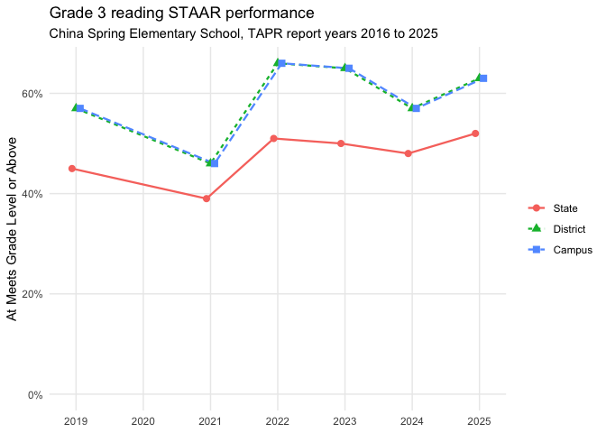
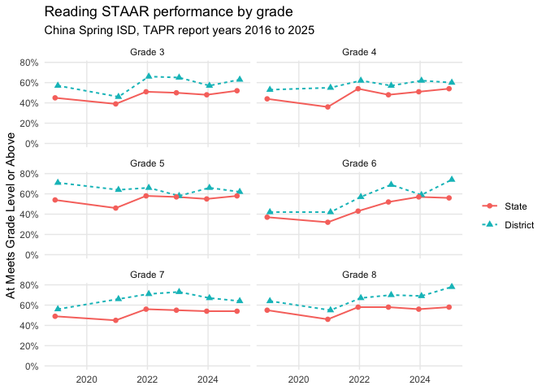
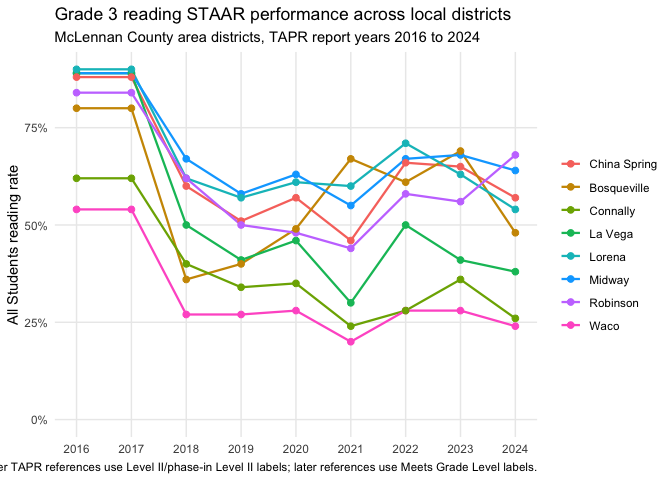
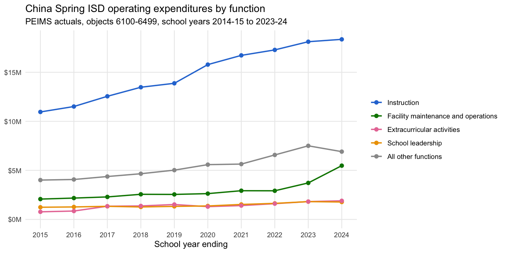
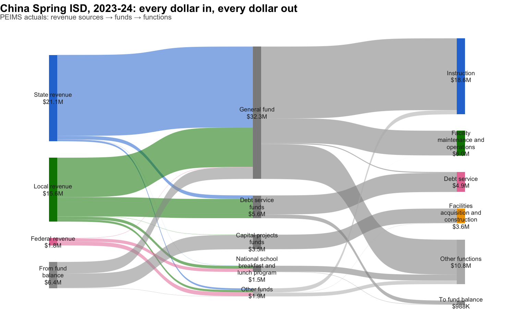

# txschools

`txschools` provides reproducible, polite, on-demand access to
**public** school-performance data published by the Texas Education
Agency (TEA):

- **TAPR** (Texas Academic Performance Reports, 2013-present):
  per-campus semantic datasets via
  [`txs_get_tapr()`](https://dkahle.github.io/txschools/reference/txs_get_tapr.md),
  statewide data files via
  [`txs_get_tapr_file()`](https://dkahle.github.io/txschools/reference/txs_get_tapr_file.md),
  and the variable dictionary via
  [`txs_get_tapr_dictionary()`](https://dkahle.github.io/txschools/reference/txs_get_tapr_dictionary.md).
- **SRC** (School Report Card, 2004-2019): per-campus reports via
  [`txs_get_src()`](https://dkahle.github.io/txschools/reference/txs_get_src.md)
  – parsed into tidy data for the 2004-2012 HTML era, cached as PDFs for
  2013-2019. (2020+ SRC lives at [txschools.gov](https://txschools.gov),
  which this package does not scrape.)
- **AEIS** (Academic Excellence Indicator System, 2004-2012): statewide
  data files via
  [`txs_get_aeis()`](https://dkahle.github.io/txschools/reference/txs_get_aeis.md).
- **PEIMS financial data** (1999-2000-present): statewide
  fund/function/object-level district and charter budgets and actuals
  via
  [`txs_get_peims_finance()`](https://dkahle.github.io/txschools/reference/txs_get_peims_finance.md),
  with optional DuckDB output via
  [`txs_write_peims_db()`](https://dkahle.github.io/txschools/reference/txs_write_peims_db.md).

Every table these functions return is documented in a machine-readable
data dictionary – column types, ranges, masking semantics,
relationships, and a glossary of TEA terms – in the
[data-dict.yaml](https://data-dict.tidyverse.org) format, shipped with
the package:

``` r

system.file("data-dict.yaml", package = "txschools")
```

## Disclaimer

`txschools` is **not affiliated with or endorsed by the Texas Education
Agency**. It downloads files from TEA’s *public* TAPR/SRC/AEIS pages on
demand and does **not** redistribute TEA data. Users are responsible for
compliance with [TEA’s site
policies](https://tea.texas.gov/about-tea/welcome-and-overview/site-policies)
and with FERPA and other applicable privacy laws. Masking and
suppression values applied by TEA are preserved exactly; this package
**never imputes or infers masked values**.

## Installation

``` r

# install.packages("pak")
pak::pak("dkahle/txschools")
```

## Quick start

``` r

# Load the packages used throughout the examples.
library("tidyverse"); library("patchwork"); library("scales", warn.conflicts = FALSE)
theme_set(theme_minimal()); theme_update(panel.grid.minor = element_blank())
library("txschools")
```

Here is a real public TAPR/TPRS example: China Spring Elementary School
(`161920102`) for TEA report year 2025, which corresponds to the 2024-25
TAPR report. The 2025 campus report is currently exposed by TEA as an
HTML report page, so this example uses
[`txs_get_tapr()`](https://dkahle.github.io/txschools/reference/txs_get_tapr.md)
to politely request the public page and parse its student-information
datasets.

The `geography` value is TEA’s organization identifier: for a campus,
the nine-digit county-district-campus number (the first six digits
identify the district, the last three the campus). Keep these
identifiers quoted in R so leading zeros, where present, are preserved.

You don’t need to know the number in advance – look it up by name with
[`txs_find_campus()`](https://dkahle.github.io/txschools/reference/txs_find_campus.md)
(or
[`txs_find_district()`](https://dkahle.github.io/txschools/reference/txs_find_campus.md)),
which searches a directory built from TEA’s public statewide reference
data:

``` r

txs_find_campus("china spring")
#> # A tibble: 7 × 9
#>    year level  id     name  district district_name county_name region grade_span
#>   <int> <chr>  <chr>  <chr> <chr>    <chr>         <chr>       <chr>  <chr>     
#> 1  2024 campus 16192… CHIN… 161920   CHINA SPRING… MCLENNAN    12     09 - 12   
#> 2  2024 campus 16192… TAG   161920   CHINA SPRING… MCLENNAN    12     10 - 12   
#> 3  2024 campus 16192… CHAL… 161920   CHINA SPRING… MCLENNAN    12     07 - 11   
#> 4  2024 campus 16192… CHIN… 161920   CHINA SPRING… MCLENNAN    12     07 - 08   
#> 5  2024 campus 16192… CHIN… 161920   CHINA SPRING… MCLENNAN    12     02 - 04   
#> 6  2024 campus 16192… CHIN… 161920   CHINA SPRING… MCLENNAN    12     05 - 06   
#> 7  2024 campus 16192… CHIN… 161920   CHINA SPRING… MCLENNAN    12     EE - 01
```

China Spring Elementary School is campus `102` in China Spring ISD
(`161920`), so its TAPR campus `geography` is `"161920102"`.

[`txs_get_tapr()`](https://dkahle.github.io/txschools/reference/txs_get_tapr.md)
returns a named list of semantic datasets. This reflects the structure
of TAPR itself: the report is not one table, but a collection of related
tables.

``` r

# Request just a few semantic TAPR tables for one campus.
china_spring_elem_2025 <- txs_get_tapr(
  year = 2025,
  level = "campus",
  geography = "161920102",
  datasets = c("grade", "sex", "cohorts")
)

# the output of txs_get_tapr() is a tapr object
china_spring_elem_2025
#> <tapr>
#> * grade: 6 rows
#> * sex: 4 rows
#> * cohorts: 26 rows

china_spring_elem_2025 |> str(max.level = 1)
#> List of 3
#>  $ grade  : tibble [6 × 23] (S3: tbl_df/tbl/data.frame)
#>  $ sex    : tibble [4 × 23] (S3: tbl_df/tbl/data.frame)
#>  $ cohorts: tibble [26 × 23] (S3: tbl_df/tbl/data.frame)
#>  - attr(*, "txschools")=List of 8
#>  - attr(*, "class")= chr [1:2] "tapr" "list"

china_spring_elem_2025 |> pluck("grade") |> glimpse()
#> Rows: 6
#> Columns: 23
#> $ year                       <int> 2025, 2025, 2025, 2025, 2025, 2025
#> $ school_year                <chr> "2024-25", "2024-25", "2024-25", "2024-25",…
#> $ level                      <chr> "campus", "campus", "campus", "campus", "ca…
#> $ geography                  <chr> "161920102", "161920102", "161920102", "161…
#> $ entity_name                <chr> "CHINA SPRING EL", "CHINA SPRING EL", "CHIN…
#> $ district_name              <chr> "CHINA SPRING ISD", "CHINA SPRING ISD", "CH…
#> $ county_name                <chr> "MCLENNAN COUNTY", "MCLENNAN COUNTY", "MCLE…
#> $ source_url                 <chr> "https://rptsvr1.tea.texas.gov/cgi/sas/brok…
#> $ retrieved_at               <chr> "2026-07-07T17:43:54Z", "2026-07-07T17:43:5…
#> $ basis                      <chr> "membership", "enrollment", "membership", "…
#> $ grade                      <chr> "Grade 2", "Grade 2", "Grade 3", "Grade 3",…
#> $ count                      <int> 181, 181, 203, 203, 229, 229
#> $ count_masked               <lgl> FALSE, FALSE, FALSE, FALSE, FALSE, FALSE
#> $ count_mask_code            <chr> NA, NA, NA, NA, NA, NA
#> $ campus_percent             <dbl> 0.295, 0.295, 0.331, 0.331, 0.374, 0.374
#> $ campus_percent_masked      <lgl> FALSE, FALSE, FALSE, FALSE, FALSE, FALSE
#> $ campus_percent_mask_code   <chr> NA, NA, NA, NA, NA, NA
#> $ district_percent           <dbl> 0.060, 0.060, 0.067, 0.067, 0.076, 0.076
#> $ district_percent_masked    <lgl> FALSE, FALSE, FALSE, FALSE, FALSE, FALSE
#> $ district_percent_mask_code <chr> NA, NA, NA, NA, NA, NA
#> $ state_percent              <dbl> 0.070, 0.070, 0.073, 0.073, 0.073, 0.073
#> $ state_percent_masked       <lgl> FALSE, FALSE, FALSE, FALSE, FALSE, FALSE
#> $ state_percent_mask_code    <chr> NA, NA, NA, NA, NA, NA

china_spring_elem_2025 |> pluck("sex") |> glimpse()
#> Rows: 4
#> Columns: 23
#> $ year                       <int> 2025, 2025, 2025, 2025
#> $ school_year                <chr> "2024-25", "2024-25", "2024-25", "2024-25"
#> $ level                      <chr> "campus", "campus", "campus", "campus"
#> $ geography                  <chr> "161920102", "161920102", "161920102", "161…
#> $ entity_name                <chr> "CHINA SPRING EL", "CHINA SPRING EL", "CHIN…
#> $ district_name              <chr> "CHINA SPRING ISD", "CHINA SPRING ISD", "CH…
#> $ county_name                <chr> "MCLENNAN COUNTY", "MCLENNAN COUNTY", "MCLE…
#> $ source_url                 <chr> "https://rptsvr1.tea.texas.gov/cgi/sas/brok…
#> $ retrieved_at               <chr> "2026-07-07T17:43:54Z", "2026-07-07T17:43:5…
#> $ basis                      <chr> "membership", "enrollment", "membership", "…
#> $ sex                        <chr> "Female", "Female", "Male", "Male"
#> $ count                      <int> 304, 304, 309, 309
#> $ count_masked               <lgl> FALSE, FALSE, FALSE, FALSE
#> $ count_mask_code            <chr> NA, NA, NA, NA
#> $ campus_percent             <dbl> 0.496, 0.496, 0.504, 0.504
#> $ campus_percent_masked      <lgl> FALSE, FALSE, FALSE, FALSE
#> $ campus_percent_mask_code   <chr> NA, NA, NA, NA
#> $ district_percent           <dbl> 0.484, 0.484, 0.516, 0.516
#> $ district_percent_masked    <lgl> FALSE, FALSE, FALSE, FALSE
#> $ district_percent_mask_code <chr> NA, NA, NA, NA
#> $ state_percent              <dbl> 0.489, 0.488, 0.511, 0.512
#> $ state_percent_masked       <lgl> FALSE, FALSE, FALSE, FALSE
#> $ state_percent_mask_code    <chr> NA, NA, NA, NA

china_spring_elem_2025 |> pluck("cohorts") |> glimpse()
#> Rows: 26
#> Columns: 23
#> $ year                       <int> 2025, 2025, 2025, 2025, 2025, 2025, 2025, 2…
#> $ school_year                <chr> "2024-25", "2024-25", "2024-25", "2024-25",…
#> $ level                      <chr> "campus", "campus", "campus", "campus", "ca…
#> $ geography                  <chr> "161920102", "161920102", "161920102", "161…
#> $ entity_name                <chr> "CHINA SPRING EL", "CHINA SPRING EL", "CHIN…
#> $ district_name              <chr> "CHINA SPRING ISD", "CHINA SPRING ISD", "CH…
#> $ county_name                <chr> "MCLENNAN COUNTY", "MCLENNAN COUNTY", "MCLE…
#> $ source_url                 <chr> "https://rptsvr1.tea.texas.gov/cgi/sas/brok…
#> $ retrieved_at               <chr> "2026-07-07T17:43:54Z", "2026-07-07T17:43:5…
#> $ basis                      <chr> "membership", "enrollment", "membership", "…
#> $ cohort                     <chr> "Economically Disadvantaged", "Economically…
#> $ count                      <int> 229, 229, 384, 384, 41, 41, 22, 22, 0, NA, …
#> $ count_masked               <lgl> FALSE, FALSE, FALSE, FALSE, FALSE, FALSE, F…
#> $ count_mask_code            <chr> NA, NA, NA, NA, NA, NA, NA, NA, NA, NA, NA,…
#> $ campus_percent             <dbl> 0.374, 0.374, 0.626, 0.626, 0.067, 0.067, 0…
#> $ campus_percent_masked      <lgl> FALSE, FALSE, FALSE, FALSE, FALSE, FALSE, F…
#> $ campus_percent_mask_code   <chr> NA, NA, NA, NA, NA, NA, NA, NA, NA, NA, NA,…
#> $ district_percent           <dbl> 0.338, 0.338, 0.662, 0.662, 0.151, 0.151, 0…
#> $ district_percent_masked    <lgl> FALSE, FALSE, FALSE, FALSE, FALSE, FALSE, F…
#> $ district_percent_mask_code <chr> NA, NA, NA, NA, NA, NA, NA, NA, NA, NA, NA,…
#> $ state_percent              <dbl> 0.605, 0.604, 0.395, 0.396, 0.068, 0.068, 0…
#> $ state_percent_masked       <lgl> FALSE, FALSE, FALSE, FALSE, FALSE, FALSE, F…
#> $ state_percent_mask_code    <chr> NA, NA, NA, NA, NA, NA, NA, NA, NA, NA, NA,…
```

If `datasets` is unspecified,
[`txs_get_tapr()`](https://dkahle.github.io/txschools/reference/txs_get_tapr.md)
grabs all the information it can.
[`txs_list_tapr_datasets()`](https://dkahle.github.io/txschools/reference/txs_list_tapr_datasets.md)
can be used to see the currently supported semantic dataset keys.

``` r

txs_list_tapr_datasets()
#> # A tibble: 18 × 5
#>    key               label                             page_source grain columns
#>    <chr>             <chr>                             <chr>       <chr> <chr>  
#>  1 grade             Student enrollment by grade       student     camp… year, …
#>  2 ethnic            Student ethnic distribution       student     camp… year, …
#>  3 sex               Student sex distribution          student     camp… year, …
#>  4 cohorts           Other student cohorts             student     camp… year, …
#>  5 program           Students by instructional program student     camp… year, …
#>  6 disability        Students with disabilities by pr… student     camp… year, …
#>  7 mobility          Student mobility                  student     camp… year, …
#>  8 attrition         Student attrition                 student     camp… year, …
#>  9 retention         Student retention                 student     camp… year, …
#> 10 class_size        Average class size                student     camp… year, …
#> 11 staar_performance STAAR performance                 staar_perf… camp… year, …
#> 12 staar_progress    STAAR progress                    staar_prog… camp… year, …
#> 13 bilingual_esl     Bilingual education and English … bilingual_… camp… year, …
#> 14 ccmr              College, career, and military re… ccmr        camp… year, …
#> 15 graduation        Graduation                        graduation  camp… year, …
#> 16 attendance        Attendance                        attendance  camp… year, …
#> 17 staff             Staff information                 staff       camp… year, …
#> 18 finance           Finance                           finance     camp… year, …
```

So a typical basic useage for
[`txs_get_tapr()`](https://dkahle.github.io/txschools/reference/txs_get_tapr.md)
for one year would be:

``` r

(china_spring_elem_2025 <- txs_get_tapr(year = 2025, level = "campus", geography = "161920102"))
#> <tapr>
#> * grade: 6 rows
#> * ethnic: 14 rows
#> * sex: 4 rows
#> * cohorts: 26 rows
#> * program: 10 rows
#> * disability: 12 rows
#> * mobility: 26 rows
#> * attrition: 4 rows
#> * retention: 0 rows
#> * class_size: 0 rows
#> * staar_performance: 1131 rows
#> * staar_progress: 1162 rows
#> * bilingual_esl: 765 rows
#> * ccmr: 7 rows
#> * graduation: 920 rows
#> * attendance: 0 rows
#> * staff: 102 rows
#> * finance: 0 rows

china_spring_elem_2025 |> pluck("graduation") |> glimpse()
#> Rows: 920
#> Columns: 19
#> $ year          <int> 2025, 2025, 2025, 2025, 2025, 2025, 2025, 2025, 2025, 20…
#> $ school_year   <chr> "2024-25", "2024-25", "2024-25", "2024-25", "2024-25", "…
#> $ level         <chr> "campus", "campus", "campus", "campus", "campus", "campu…
#> $ geography     <chr> "161920102", "161920102", "161920102", "161920102", "161…
#> $ entity_name   <chr> "CHINA SPRING EL", "CHINA SPRING EL", "CHINA SPRING EL",…
#> $ district_name <chr> "CHINA SPRING ISD", "CHINA SPRING ISD", "CHINA SPRING IS…
#> $ county_name   <chr> "MCLENNAN COUNTY", "MCLENNAN COUNTY", "MCLENNAN COUNTY",…
#> $ source_url    <chr> "https://rptsvr1.tea.texas.gov/cgi/sas/broker?_debug=0&_…
#> $ retrieved_at  <chr> "2026-07-07T17:44:03Z", "2026-07-07T17:44:03Z", "2026-07…
#> $ page_source   <chr> "graduation", "graduation", "graduation", "graduation", …
#> $ table_index   <int> 2, 2, 2, 2, 2, 2, 2, 3, 3, 3, 3, 3, 3, 3, 3, 3, 3, 3, 3,…
#> $ row_index     <int> 1, 1, 1, 1, 1, 1, 1, 2, 2, 2, 2, 2, 2, 2, 2, 2, 2, 2, 2,…
#> $ section       <chr> NA, NA, NA, NA, NA, NA, NA, "Attendance Rate", "Attendan…
#> $ row_label     <chr> "2018-19", "2018-19", "2018-19", "2018-19", "2018-19", "…
#> $ column        <chr> "X2", "X3", "X4", "X5", "X6", "X7", "X8", "State", "Dist…
#> $ value         <chr> "2019-20", "2020-21", "2021-22", "2022-23", "2023-24", "…
#> $ value_num     <dbl> NA, NA, NA, NA, NA, NA, NA, 93.9, 95.8, 96.3, 97.4, 96.0…
#> $ masked        <lgl> FALSE, FALSE, FALSE, FALSE, FALSE, FALSE, FALSE, FALSE, …
#> $ mask_code     <chr> NA, NA, NA, NA, NA, NA, NA, NA, NA, NA, NA, NA, NA, "*",…
china_spring_elem_2025 |> pluck("staar_performance") |> glimpse()
#> Rows: 1,131
#> Columns: 19
#> $ year          <int> 2025, 2025, 2025, 2025, 2025, 2025, 2025, 2025, 2025, 20…
#> $ school_year   <chr> "2024-25", "2024-25", "2024-25", "2024-25", "2024-25", "…
#> $ level         <chr> "campus", "campus", "campus", "campus", "campus", "campu…
#> $ geography     <chr> "161920102", "161920102", "161920102", "161920102", "161…
#> $ entity_name   <chr> "CHINA SPRING EL", "CHINA SPRING EL", "CHINA SPRING EL",…
#> $ district_name <chr> "CHINA SPRING ISD", "CHINA SPRING ISD", "CHINA SPRING IS…
#> $ county_name   <chr> "MCLENNAN COUNTY", "MCLENNAN COUNTY", "MCLENNAN COUNTY",…
#> $ source_url    <chr> "https://rptsvr1.tea.texas.gov/cgi/sas/broker?_debug=0&_…
#> $ retrieved_at  <chr> "2026-07-07T17:43:55Z", "2026-07-07T17:43:55Z", "2026-07…
#> $ page_source   <chr> "staar_performance", "staar_performance", "staar_perform…
#> $ table_index   <int> 2, 2, 2, 2, 2, 2, 2, 3, 3, 3, 3, 3, 3, 3, 3, 3, 3, 3, 3,…
#> $ row_index     <int> 1, 1, 1, 1, 1, 1, 1, 3, 3, 3, 3, 3, 3, 3, 3, 3, 3, 3, 3,…
#> $ section       <chr> NA, NA, NA, NA, NA, NA, NA, "Grade 3 Reading", "Grade 3 …
#> $ row_label     <chr> "2018-19", "2018-19", "2018-19", "2018-19", "2018-19", "…
#> $ column        <chr> "X2", "X3", "X4", "X5", "X6", "X7", "X8", "SchoolYear", …
#> $ value         <chr> "2019-20", "2020-21", "2021-22", "2022-23", "2023-24", "…
#> $ value_num     <dbl> NA, NA, NA, NA, NA, NA, NA, 2025, 77, 89, 89, 85, 78, 94…
#> $ masked        <lgl> FALSE, FALSE, FALSE, FALSE, FALSE, FALSE, FALSE, FALSE, …
#> $ mask_code     <chr> NA, NA, NA, NA, NA, NA, NA, NA, NA, NA, NA, NA, NA, NA, …
china_spring_elem_2025 |> pluck("staar_performance") |> head()
#> # A tibble: 6 × 19
#>    year school_year level  geography entity_name     district_name   county_name
#>   <int> <chr>       <chr>  <chr>     <chr>           <chr>           <chr>      
#> 1  2025 2024-25     campus 161920102 CHINA SPRING EL CHINA SPRING I… MCLENNAN C…
#> 2  2025 2024-25     campus 161920102 CHINA SPRING EL CHINA SPRING I… MCLENNAN C…
#> 3  2025 2024-25     campus 161920102 CHINA SPRING EL CHINA SPRING I… MCLENNAN C…
#> 4  2025 2024-25     campus 161920102 CHINA SPRING EL CHINA SPRING I… MCLENNAN C…
#> 5  2025 2024-25     campus 161920102 CHINA SPRING EL CHINA SPRING I… MCLENNAN C…
#> 6  2025 2024-25     campus 161920102 CHINA SPRING EL CHINA SPRING I… MCLENNAN C…
#> # ℹ 12 more variables: source_url <chr>, retrieved_at <chr>, page_source <chr>,
#> #   table_index <int>, row_index <int>, section <chr>, row_label <chr>,
#> #   column <chr>, value <chr>, value_num <dbl>, masked <lgl>, mask_code <chr>
china_spring_elem_2025 |> pluck("staff") |> print(n = Inf)
#> # A tibble: 102 × 19
#>      year school_year level  geography entity_name     district_name county_name
#>     <int> <chr>       <chr>  <chr>     <chr>           <chr>         <chr>      
#>   1  2025 2024-25     campus 161920102 CHINA SPRING EL CHINA SPRING… MCLENNAN C…
#>   2  2025 2024-25     campus 161920102 CHINA SPRING EL CHINA SPRING… MCLENNAN C…
#>   3  2025 2024-25     campus 161920102 CHINA SPRING EL CHINA SPRING… MCLENNAN C…
#>   4  2025 2024-25     campus 161920102 CHINA SPRING EL CHINA SPRING… MCLENNAN C…
#>   5  2025 2024-25     campus 161920102 CHINA SPRING EL CHINA SPRING… MCLENNAN C…
#>   6  2025 2024-25     campus 161920102 CHINA SPRING EL CHINA SPRING… MCLENNAN C…
#>   7  2025 2024-25     campus 161920102 CHINA SPRING EL CHINA SPRING… MCLENNAN C…
#>   8  2025 2024-25     campus 161920102 CHINA SPRING EL CHINA SPRING… MCLENNAN C…
#>   9  2025 2024-25     campus 161920102 CHINA SPRING EL CHINA SPRING… MCLENNAN C…
#>  10  2025 2024-25     campus 161920102 CHINA SPRING EL CHINA SPRING… MCLENNAN C…
#>  11  2025 2024-25     campus 161920102 CHINA SPRING EL CHINA SPRING… MCLENNAN C…
#>  12  2025 2024-25     campus 161920102 CHINA SPRING EL CHINA SPRING… MCLENNAN C…
#>  13  2025 2024-25     campus 161920102 CHINA SPRING EL CHINA SPRING… MCLENNAN C…
#>  14  2025 2024-25     campus 161920102 CHINA SPRING EL CHINA SPRING… MCLENNAN C…
#>  15  2025 2024-25     campus 161920102 CHINA SPRING EL CHINA SPRING… MCLENNAN C…
#>  16  2025 2024-25     campus 161920102 CHINA SPRING EL CHINA SPRING… MCLENNAN C…
#>  17  2025 2024-25     campus 161920102 CHINA SPRING EL CHINA SPRING… MCLENNAN C…
#>  18  2025 2024-25     campus 161920102 CHINA SPRING EL CHINA SPRING… MCLENNAN C…
#>  19  2025 2024-25     campus 161920102 CHINA SPRING EL CHINA SPRING… MCLENNAN C…
#>  20  2025 2024-25     campus 161920102 CHINA SPRING EL CHINA SPRING… MCLENNAN C…
#>  21  2025 2024-25     campus 161920102 CHINA SPRING EL CHINA SPRING… MCLENNAN C…
#>  22  2025 2024-25     campus 161920102 CHINA SPRING EL CHINA SPRING… MCLENNAN C…
#>  23  2025 2024-25     campus 161920102 CHINA SPRING EL CHINA SPRING… MCLENNAN C…
#>  24  2025 2024-25     campus 161920102 CHINA SPRING EL CHINA SPRING… MCLENNAN C…
#>  25  2025 2024-25     campus 161920102 CHINA SPRING EL CHINA SPRING… MCLENNAN C…
#>  26  2025 2024-25     campus 161920102 CHINA SPRING EL CHINA SPRING… MCLENNAN C…
#>  27  2025 2024-25     campus 161920102 CHINA SPRING EL CHINA SPRING… MCLENNAN C…
#>  28  2025 2024-25     campus 161920102 CHINA SPRING EL CHINA SPRING… MCLENNAN C…
#>  29  2025 2024-25     campus 161920102 CHINA SPRING EL CHINA SPRING… MCLENNAN C…
#>  30  2025 2024-25     campus 161920102 CHINA SPRING EL CHINA SPRING… MCLENNAN C…
#>  31  2025 2024-25     campus 161920102 CHINA SPRING EL CHINA SPRING… MCLENNAN C…
#>  32  2025 2024-25     campus 161920102 CHINA SPRING EL CHINA SPRING… MCLENNAN C…
#>  33  2025 2024-25     campus 161920102 CHINA SPRING EL CHINA SPRING… MCLENNAN C…
#>  34  2025 2024-25     campus 161920102 CHINA SPRING EL CHINA SPRING… MCLENNAN C…
#>  35  2025 2024-25     campus 161920102 CHINA SPRING EL CHINA SPRING… MCLENNAN C…
#>  36  2025 2024-25     campus 161920102 CHINA SPRING EL CHINA SPRING… MCLENNAN C…
#>  37  2025 2024-25     campus 161920102 CHINA SPRING EL CHINA SPRING… MCLENNAN C…
#>  38  2025 2024-25     campus 161920102 CHINA SPRING EL CHINA SPRING… MCLENNAN C…
#>  39  2025 2024-25     campus 161920102 CHINA SPRING EL CHINA SPRING… MCLENNAN C…
#>  40  2025 2024-25     campus 161920102 CHINA SPRING EL CHINA SPRING… MCLENNAN C…
#>  41  2025 2024-25     campus 161920102 CHINA SPRING EL CHINA SPRING… MCLENNAN C…
#>  42  2025 2024-25     campus 161920102 CHINA SPRING EL CHINA SPRING… MCLENNAN C…
#>  43  2025 2024-25     campus 161920102 CHINA SPRING EL CHINA SPRING… MCLENNAN C…
#>  44  2025 2024-25     campus 161920102 CHINA SPRING EL CHINA SPRING… MCLENNAN C…
#>  45  2025 2024-25     campus 161920102 CHINA SPRING EL CHINA SPRING… MCLENNAN C…
#>  46  2025 2024-25     campus 161920102 CHINA SPRING EL CHINA SPRING… MCLENNAN C…
#>  47  2025 2024-25     campus 161920102 CHINA SPRING EL CHINA SPRING… MCLENNAN C…
#>  48  2025 2024-25     campus 161920102 CHINA SPRING EL CHINA SPRING… MCLENNAN C…
#>  49  2025 2024-25     campus 161920102 CHINA SPRING EL CHINA SPRING… MCLENNAN C…
#>  50  2025 2024-25     campus 161920102 CHINA SPRING EL CHINA SPRING… MCLENNAN C…
#>  51  2025 2024-25     campus 161920102 CHINA SPRING EL CHINA SPRING… MCLENNAN C…
#>  52  2025 2024-25     campus 161920102 CHINA SPRING EL CHINA SPRING… MCLENNAN C…
#>  53  2025 2024-25     campus 161920102 CHINA SPRING EL CHINA SPRING… MCLENNAN C…
#>  54  2025 2024-25     campus 161920102 CHINA SPRING EL CHINA SPRING… MCLENNAN C…
#>  55  2025 2024-25     campus 161920102 CHINA SPRING EL CHINA SPRING… MCLENNAN C…
#>  56  2025 2024-25     campus 161920102 CHINA SPRING EL CHINA SPRING… MCLENNAN C…
#>  57  2025 2024-25     campus 161920102 CHINA SPRING EL CHINA SPRING… MCLENNAN C…
#>  58  2025 2024-25     campus 161920102 CHINA SPRING EL CHINA SPRING… MCLENNAN C…
#>  59  2025 2024-25     campus 161920102 CHINA SPRING EL CHINA SPRING… MCLENNAN C…
#>  60  2025 2024-25     campus 161920102 CHINA SPRING EL CHINA SPRING… MCLENNAN C…
#>  61  2025 2024-25     campus 161920102 CHINA SPRING EL CHINA SPRING… MCLENNAN C…
#>  62  2025 2024-25     campus 161920102 CHINA SPRING EL CHINA SPRING… MCLENNAN C…
#>  63  2025 2024-25     campus 161920102 CHINA SPRING EL CHINA SPRING… MCLENNAN C…
#>  64  2025 2024-25     campus 161920102 CHINA SPRING EL CHINA SPRING… MCLENNAN C…
#>  65  2025 2024-25     campus 161920102 CHINA SPRING EL CHINA SPRING… MCLENNAN C…
#>  66  2025 2024-25     campus 161920102 CHINA SPRING EL CHINA SPRING… MCLENNAN C…
#>  67  2025 2024-25     campus 161920102 CHINA SPRING EL CHINA SPRING… MCLENNAN C…
#>  68  2025 2024-25     campus 161920102 CHINA SPRING EL CHINA SPRING… MCLENNAN C…
#>  69  2025 2024-25     campus 161920102 CHINA SPRING EL CHINA SPRING… MCLENNAN C…
#>  70  2025 2024-25     campus 161920102 CHINA SPRING EL CHINA SPRING… MCLENNAN C…
#>  71  2025 2024-25     campus 161920102 CHINA SPRING EL CHINA SPRING… MCLENNAN C…
#>  72  2025 2024-25     campus 161920102 CHINA SPRING EL CHINA SPRING… MCLENNAN C…
#>  73  2025 2024-25     campus 161920102 CHINA SPRING EL CHINA SPRING… MCLENNAN C…
#>  74  2025 2024-25     campus 161920102 CHINA SPRING EL CHINA SPRING… MCLENNAN C…
#>  75  2025 2024-25     campus 161920102 CHINA SPRING EL CHINA SPRING… MCLENNAN C…
#>  76  2025 2024-25     campus 161920102 CHINA SPRING EL CHINA SPRING… MCLENNAN C…
#>  77  2025 2024-25     campus 161920102 CHINA SPRING EL CHINA SPRING… MCLENNAN C…
#>  78  2025 2024-25     campus 161920102 CHINA SPRING EL CHINA SPRING… MCLENNAN C…
#>  79  2025 2024-25     campus 161920102 CHINA SPRING EL CHINA SPRING… MCLENNAN C…
#>  80  2025 2024-25     campus 161920102 CHINA SPRING EL CHINA SPRING… MCLENNAN C…
#>  81  2025 2024-25     campus 161920102 CHINA SPRING EL CHINA SPRING… MCLENNAN C…
#>  82  2025 2024-25     campus 161920102 CHINA SPRING EL CHINA SPRING… MCLENNAN C…
#>  83  2025 2024-25     campus 161920102 CHINA SPRING EL CHINA SPRING… MCLENNAN C…
#>  84  2025 2024-25     campus 161920102 CHINA SPRING EL CHINA SPRING… MCLENNAN C…
#>  85  2025 2024-25     campus 161920102 CHINA SPRING EL CHINA SPRING… MCLENNAN C…
#>  86  2025 2024-25     campus 161920102 CHINA SPRING EL CHINA SPRING… MCLENNAN C…
#>  87  2025 2024-25     campus 161920102 CHINA SPRING EL CHINA SPRING… MCLENNAN C…
#>  88  2025 2024-25     campus 161920102 CHINA SPRING EL CHINA SPRING… MCLENNAN C…
#>  89  2025 2024-25     campus 161920102 CHINA SPRING EL CHINA SPRING… MCLENNAN C…
#>  90  2025 2024-25     campus 161920102 CHINA SPRING EL CHINA SPRING… MCLENNAN C…
#>  91  2025 2024-25     campus 161920102 CHINA SPRING EL CHINA SPRING… MCLENNAN C…
#>  92  2025 2024-25     campus 161920102 CHINA SPRING EL CHINA SPRING… MCLENNAN C…
#>  93  2025 2024-25     campus 161920102 CHINA SPRING EL CHINA SPRING… MCLENNAN C…
#>  94  2025 2024-25     campus 161920102 CHINA SPRING EL CHINA SPRING… MCLENNAN C…
#>  95  2025 2024-25     campus 161920102 CHINA SPRING EL CHINA SPRING… MCLENNAN C…
#>  96  2025 2024-25     campus 161920102 CHINA SPRING EL CHINA SPRING… MCLENNAN C…
#>  97  2025 2024-25     campus 161920102 CHINA SPRING EL CHINA SPRING… MCLENNAN C…
#>  98  2025 2024-25     campus 161920102 CHINA SPRING EL CHINA SPRING… MCLENNAN C…
#>  99  2025 2024-25     campus 161920102 CHINA SPRING EL CHINA SPRING… MCLENNAN C…
#> 100  2025 2024-25     campus 161920102 CHINA SPRING EL CHINA SPRING… MCLENNAN C…
#> 101  2025 2024-25     campus 161920102 CHINA SPRING EL CHINA SPRING… MCLENNAN C…
#> 102  2025 2024-25     campus 161920102 CHINA SPRING EL CHINA SPRING… MCLENNAN C…
#> # ℹ 12 more variables: source_url <chr>, retrieved_at <chr>, page_source <chr>,
#> #   table_index <int>, row_index <int>, section <chr>, row_label <chr>,
#> #   column <chr>, value <chr>, value_num <dbl>, masked <lgl>, mask_code <chr>
```

Here is a small longitudinal visualization using the same campus. This
pulls the semantic STAAR performance table for 10 report years, keeps
one Grade 3 reading measure, and compares the campus to its district and
the state. TEA’s report tables nest measures under section headings
(“Grade 3 Reading” \> “At Meets Grade Level or Above”), which the parsed
data exposes as `section` and `row_label`; each page also repeats the
prior year’s row, so we keep the row whose `SchoolYear` matches the
report year. The series use both color and line type because the campus
and district can land on the same values; in this case, China Spring
Elementary is the only district campus serving Grade 3, so the campus
and district series are expected to overlap.

``` r

staar_years <- 2016:2025

# Pull the semantic STAAR table once for all requested years.
china_spring_elem_staar <- txs_get_tapr(
  year = staar_years,
  level = "campus",
  geography = "161920102",
  datasets = "staar_performance"
)

# Keep the current-year Grade 3 reading row and reshape comparisons long.
staar_grade3_reading <- china_spring_elem_staar$staar_performance |>
  filter(
    section == "Grade 3 Reading",
    row_label == "At Meets Grade Level or Above",
    column %in% c("SchoolYear", "Campus", "District", "State")
  ) |>
  select(year, table_index, row_index, column, value_num) |>
  pivot_wider(names_from = column, values_from = value_num) |>
  filter(SchoolYear == year) |>
  select(year, Campus, District, State) |>
  pivot_longer(-year, names_to = "comparison", values_to = "rate") |>
  mutate(
    comparison = factor(comparison, levels = c("State", "District", "Campus")),
    rate = rate / 100
  ) |>
  drop_na(rate) |>
  arrange(comparison, year)

# Offset overlapping campus/district points without changing the values.
overlap_offset <- position_dodge(width = 0.18)

ggplot(
  staar_grade3_reading,
  aes(
    x = year,
    y = rate,
    color = comparison,
    linetype = comparison,
    shape = comparison,
    group = comparison
  )
) +
  geom_line(linewidth = 0.8, position = overlap_offset) +
  geom_point(size = 2.5, position = overlap_offset) +
  scale_x_continuous(breaks = staar_years) +
  scale_y_continuous(labels = percent, limits = c(0, NA)) +
  labs(
    x = NULL,
    y = "At Meets Grade Level or Above",
    color = NULL,
    linetype = NULL,
    shape = NULL,
    title = "Grade 3 reading STAAR performance",
    subtitle = paste(
      "China Spring Elementary School, TAPR report years",
      min(staar_years), "to", max(staar_years)
    )
  )
```



For the district as a whole, use the district-level TAPR report and
facet the same reading measure by grade. This drops the campus line
because the unit of analysis is China Spring ISD rather than one campus.

``` r

# Switch from the campus report to the district report.
china_spring_district_staar <- txs_get_tapr(
  year = staar_years,
  level = "district",
  geography = "161920",
  datasets = "staar_performance"
)

# Keep the same reading measure, now across every grade reported by the district.
district_staar_reading_by_grade <- china_spring_district_staar$staar_performance |>
  filter(
    str_detect(section, regex("^Grade \\d+ Reading", ignore_case = TRUE)),
    row_label == "At Meets Grade Level or Above",
    column %in% c("SchoolYear", "District", "State")
  ) |>
  mutate(grade = str_extract(section, "^Grade \\d+")) |>
  select(year, grade, table_index, row_index, column, value_num) |>
  pivot_wider(names_from = column, values_from = value_num) |>
  filter(SchoolYear == year) |>
  select(year, grade, District, State) |>
  pivot_longer(c(District, State), names_to = "comparison", values_to = "rate") |>
  mutate(
    comparison = factor(comparison, levels = c("State", "District")),
    rate = rate / 100
  ) |>
  drop_na(rate)

# Order facets by numeric grade rather than alphabetically.
grade_levels <- district_staar_reading_by_grade |>
  distinct(grade) |>
  mutate(grade_num = parse_number(grade)) |>
  arrange(grade_num) |>
  pull(grade)

district_staar_reading_by_grade <- district_staar_reading_by_grade |>
  mutate(grade = factor(grade, levels = grade_levels))

district_offset <- position_dodge(width = 0.18)

ggplot(
  district_staar_reading_by_grade,
  aes(
    x = year,
    y = rate,
    color = comparison,
    linetype = comparison,
    shape = comparison,
    group = comparison
  )
) +
  geom_line(linewidth = 0.7, position = district_offset) +
  geom_point(size = 2, position = district_offset) +
  facet_wrap(vars(grade), ncol = 2) +
  scale_x_continuous(breaks = seq(min(staar_years), max(staar_years), by = 2)) +
  scale_y_continuous(labels = percent, limits = c(0, NA)) +
  labs(
    x = NULL,
    y = "At Meets Grade Level or Above",
    color = NULL,
    linetype = NULL,
    shape = NULL,
    title = "Reading STAAR performance by grade",
    subtitle = paste(
      "China Spring ISD, TAPR report years",
      min(staar_years), "to", max(staar_years)
    )
  )
```



The semantic HTML report is convenient for one school or district, but
it is not the fastest tool once you compare many districts: it has to
request each report page separately. For a local comparison, use TEA’s
statewide Advanced Download files instead. The code below downloads one
district-level STAAR file per year, uses the TAPR dictionary to find the
Grade 3 reading variable, then filters locally to nearby McLennan County
districts. The dictionary lookup is the intentionally explicit part
here; this is the piece a future helper can make friendlier. This
example stops at 2024 because the package can discover the 2025 Advanced
Download data file, but not yet the corresponding district dictionary
reference.

``` r

local_staar_years <- 2016:2024

# Compare China Spring with nearby McLennan County districts.
local_district_names <- c(
  "China Spring ISD", "Midway ISD", "Waco ISD", "Lorena ISD",
  "Robinson ISD", "Connally ISD", "La Vega ISD", "Bosqueville ISD"
) |>
  str_to_upper()

local_districts <- txs_directory(2024, level = "district") |>
  mutate(name_key = str_to_upper(name)) |>
  filter(county_name == "MCLENNAN", name_key %in% local_district_names) |>
  mutate(
    district = str_remove(name, " ISD$") |>
      str_to_title() |>
      fct_relevel("China Spring")
  ) |>
  arrange(district)

# Find the year-specific Grade 3 reading rate variable in each dictionary.
grade3_reading_vars <- map_dfr(local_staar_years, \(yr) {
  txs_get_tapr_dictionary(yr, "district") |>
    mutate(label_key = str_squish(str_to_lower(label))) |>
    filter(
      str_detect(label_key, "grade\\s*3"),
      str_detect(label_key, "read"),
      str_detect(label_key, "all students"),
      str_detect(label_key, "rate"),
      str_detect(label_key, "meets|level ii")
    ) |>
    slice_head(n = 1) |>
    transmute(year = yr, variable, variable_label = label)
})

# Download one statewide file per year, then filter locally.
local_grade3_reading <- map_dfr(local_staar_years, \(yr) {
  rate_var <- grade3_reading_vars |>
    filter(year == yr) |>
    pull(variable)
  if (length(rate_var) != 1L) {
    stop("Could not identify the Grade 3 reading STAAR variable for ", yr, ".")
  }

  txs_get_tapr_file(
    year = yr,
    level = "district",
    dataset = "STAAR1",
    output = "raw",
    verbose = FALSE
  ) |>
    transmute(
      year = yr,
      geography = str_remove(str_trim(DISTRICT), "^'"),
      value = .data[[rate_var]]
    )
}) |>
  filter(geography %in% local_districts$id) |>
  mutate(
    value_num = suppressWarnings(parse_number(value)),
    rate = if_else(value_num > 1, value_num / 100, value_num)
  ) |>
  left_join(
    local_districts |> select(geography = id, district),
    by = "geography"
  ) |>
  drop_na(rate)

ggplot(
  local_grade3_reading,
  aes(x = year, y = rate, color = district, group = district)
) +
  geom_line(linewidth = 0.8) +
  geom_point(size = 2) +
  scale_x_continuous(breaks = local_staar_years) +
  scale_y_continuous(labels = percent, limits = c(0, NA)) +
  labs(
    x = NULL,
    y = "All Students reading rate",
    color = NULL,
    title = "Grade 3 reading STAAR performance across local districts",
    subtitle = paste(
      "McLennan County area districts, TAPR report years",
      min(local_staar_years), "to", max(local_staar_years)
    ),
    caption = paste(
      "Older TAPR references use Level II/phase-in Level II labels;",
      "later references use Meets Grade Level labels."
    )
  )
```



## Statewide data files

TEA publishes the statewide TAPR data through its “Advanced Download”
interface as one file per level and dataset code (`"REF"` for reference
information, `"STAAR1"` for STAAR performance, `"GRAD"` for graduation,
…).
[`txs_get_tapr_file()`](https://dkahle.github.io/txschools/reference/txs_get_tapr_file.md)
downloads one of these files; use
[`txs_list_downloads()`](https://dkahle.github.io/txschools/reference/txs_list_downloads.md)
to see the codes TEA publishes for a year, and
[`txs_get_tapr_dictionary()`](https://dkahle.github.io/txschools/reference/txs_get_tapr_dictionary.md)
for the variable-code dictionary.

``` r

# Every Texas campus's reference row, one call:
ref_2024 <- txs_get_tapr_file(2024, "campus", dataset = "REF", output = "raw")

# What do those variable codes mean?
dict_2024 <- txs_get_tapr_dictionary(2024, "campus")
```

## School Report Cards and AEIS

[`txs_get_src()`](https://dkahle.github.io/txschools/reference/txs_get_src.md)
pulls one campus’s School Report Card: parsed into a tidy masking-aware
tibble for 2004-2012 (TEA’s HTML era), downloaded and cached as the
official PDF for 2013-2019.

``` r

src_2011 <- txs_get_src(2011, "campus", "161920102")
```

[`txs_get_aeis()`](https://dkahle.github.io/txschools/reference/txs_get_aeis.md)
pulls statewide AEIS data files (2004-2012) by level and dataset code:

``` r

aeis_2011 <- txs_get_aeis(2011, "district", dataset = "ref",
                          geography = "161920")
```

## PEIMS finance

[`txs_get_peims_finance()`](https://dkahle.github.io/txschools/reference/txs_get_peims_finance.md)
pulls TEA’s statewide PEIMS financial data: fund/function/object-level
budgets and actuals for every district (or every charter school) in one
school year, from 1999-2000 onward. The tidy output joins human-readable
labels for the account codes plus district and campus names, so it is
analysis-ready:

``` r

txs_get_peims_finance(2024, "actual", "district", verbose = FALSE) |>
  filter(district == "161920") |>              # China Spring ISD
  filter(startsWith(object_code, "6")) |>      # expenditures
  summarise(spent = sum(amount), .by = function_label) |>
  arrange(desc(spent))
#> # A tibble: 18 × 2
#>    function_label                                                spent
#>    <chr>                                                         <dbl>
#>  1 INSTRUCTION                                                18552765
#>  2 FACILITY MAINTENANCE AND OPERATIONS                         6045456
#>  3 DEBT SERVICE                                                4878572
#>  4 FACILITIES ACQUISITION AND CONSTRUCTION                     3596565
#>  5 EXTRACURRICULAR ACTIVITIES                                  1897555
#>  6 SCHOOL LEADERSHIP                                           1774149
#>  7 FOOD SERVICES                                               1446373
#>  8 GENERAL ADMINISTRATION                                      1273574
#>  9 GUIDANCE COUNSELING AND EVALUATION SERVICES                 1229953
#> 10 STUDENT (PUPIL) TRANSPORTATION                              1054635
#> 11 SECURITY AND MONITORING SERVICES                             600141
#> 12 CURRICULUM DEVELOPMENT AND INSTRUCTIONAL STAFF DEVELOPMENT   403578
#> 13 HEALTH SERVICES                                              360056
#> 14 INSTRUCTIONAL LEADERSHIP                                     283679
#> 15 INSTRUCTIONAL RESOURCES AND MEDIA SERVICES                   175943
#> 16 OTHER INTERGOVERNMENTAL CHARGES                              167130
#> 17 SOCIAL WORK SERVICES                                          92870
#> 18 DATA PROCESSING SERVICES                                      82937
```

Because each call downloads (and caches) one statewide file, a
multi-year district history is just a mapped pull: each year costs one
request the first time and is read from disk after that. Here is China
Spring ISD over a decade:

``` r

china_spring <- map(2015:2024, function(yr) {
  txs_get_peims_finance(yr, "actual", "district", verbose = FALSE) |>
    filter(district == "161920")
}) |>
  list_rbind()
```

Summarizing operating expenditures (objects 6100-6499) by function area
shows where the district’s dollars go and how that has shifted as the
district has grown:

``` r

op <- china_spring |>
  filter(grepl("^6[1-4]", object_code)) |>     # operating expenditures
  mutate(area = str_to_sentence(function_label)) |>
  summarise(spent = sum(amount), .by = c(year, school_year, area)) |>
  mutate(area = fct_lump_n(area, 4, w = spent,
                           other_level = "All other functions")) |>
  summarise(spent = sum(spent), .by = c(year, school_year, area)) |>
  mutate(area = fct_reorder2(area, year, spent)) |>
  mutate(area = fct_relevel(area, "All other functions", after = Inf))

op |>
  mutate(spent = dollar(spent, scale = 1e-6, suffix = "M", accuracy = .1)) |>
  pivot_wider(id_cols = school_year, names_from = area,
              values_from = spent, names_sort = TRUE)
#> # A tibble: 10 × 6
#>    school_year Instruction Facility maintenance and ope…¹ Extracurricular acti…²
#>    <chr>       <chr>       <chr>                          <chr>                 
#>  1 2014-15     $11.0M      $2.1M                          $0.8M                 
#>  2 2015-16     $11.5M      $2.2M                          $0.9M                 
#>  3 2016-17     $12.6M      $2.3M                          $1.3M                 
#>  4 2017-18     $13.5M      $2.6M                          $1.4M                 
#>  5 2018-19     $13.9M      $2.5M                          $1.5M                 
#>  6 2019-20     $15.8M      $2.6M                          $1.3M                 
#>  7 2020-21     $16.7M      $2.9M                          $1.4M                 
#>  8 2021-22     $17.3M      $2.9M                          $1.6M                 
#>  9 2022-23     $18.1M      $3.7M                          $1.8M                 
#> 10 2023-24     $18.4M      $5.5M                          $1.9M                 
#> # ℹ abbreviated names: ¹​`Facility maintenance and operations`,
#> #   ²​`Extracurricular activities`
#> # ℹ 2 more variables: `School leadership` <chr>, `All other functions` <chr>
```

``` r

ggplot(op, aes(year, spent, color = area)) +
  geom_line(linewidth = 0.8) +
  geom_point(size = 2) +
  scale_x_continuous(breaks = 2015:2024, minor_breaks = NULL) +
  scale_y_continuous(labels = dollar_format(scale = 1e-6, suffix = "M"),
                     limits = c(0, NA)) +
  scale_color_manual(
    values = c("#2a78d6", "#008300", "#e87ba4", "#eda100", "grey60")
  ) +
  labs(
    title = "China Spring ISD operating expenditures by function",
    subtitle = "PEIMS actuals, objects 6100-6499, school years 2014-15 to 2023-24",
    x = "School year ending", y = NULL, color = NULL
  )
```



Mind the scale: a district actual file is a single ~30 MB download that
parses to several million rows, so the decade above moves ~300 MB on its
first run (and nothing after). Charter files are far smaller.

### Money-flow (Sankey) diagrams

Because every PEIMS row carries the full chart of accounts, a district’s
year can be drawn as an income-statement-style flow diagram:
[`txs_peims_flow()`](https://dkahle.github.io/txschools/reference/txs_peims_flow.md)
aggregates a pull into stage-to-stage flows and
[`txs_plot_peims_flow()`](https://dkahle.github.io/txschools/reference/txs_plot_peims_flow.md)
renders them with [ggsankey](https://github.com/davidsjoberg/ggsankey)
(a GitHub-only package:
`remotes::install_github("davidsjoberg/ggsankey")`).

The default axes trace revenue sources into *funds* and funds out to
functions. Funds are the honest join: TEA records which fund every
revenue dollar entered and which fund every expenditure left, so each
ribbon below is a genuine total, not an allocation – federal grant
dollars visibly arrive in their own funds and leave as their programs’
spending, and each fund’s shortfall or surplus reconciles against fund
balance:

``` r

txs_get_peims_finance(2024, "actual", "district", verbose = FALSE) |>
  filter(district == "161920") |>
  txs_peims_flow(lump = 4) |>
  txs_plot_peims_flow() +
  labs(
    title = "China Spring ISD, 2023-24: every dollar in, every dollar out",
    subtitle = "PEIMS actuals: revenue sources → funds → functions"
  ) +
  theme(plot.title = element_text(face = "bold", size = 15),
        plot.subtitle = element_text(color = "grey35", size = 10,
                                     margin = margin(b = 6)))
```



Deeper axes are available where the accounting supports them –
`axes = c("fund", "function", "object")` continues to the right into
what the money bought (payroll, contracted services, supplies, capital
outlay), and `"program"` splits by program intent. The flow builder
returns a plain edge-list tibble, so any other Sankey tool (plotly,
networkD3) can consume it too. For the full tour – the concepts behind
honest flow charts, deeper axis combinations, and the same charts built
with ggalluvial, plotly, and networkD3 – see
[`vignette("money-flow-diagrams")`](https://dkahle.github.io/txschools/articles/money-flow-diagrams.md).

### Multi-year analysis with DuckDB

Filtering each year down in R, as above, works when you know the
district up front. For full-grain, multi-year work – every district,
every year, ~50 million rows – holding tibbles in memory stops being
reasonable, and that is what the `db` argument is for.

[DuckDB](https://duckdb.org/) is an *in-process* analytical database: a
single file on disk, no server to install or administer –
`install.packages("duckdb")` is the entire setup. Passing `db =` to
[`txs_get_peims_finance()`](https://dkahle.github.io/txschools/reference/txs_get_peims_finance.md)
(or calling
[`txs_write_peims_db()`](https://dkahle.github.io/txschools/reference/txs_write_peims_db.md))
appends each pull to that file as a table named
`peims_finance_<basis>_<type>_<year>`, alongside a `_peims_meta`
provenance table:

``` r

library("DBI")
walk(2015:2024, function(yr) {
  txs_get_peims_finance(yr, "actual", "district", db = "peims.duckdb")
})

con <- dbConnect(duckdb::duckdb(), "peims.duckdb")
dbListTables(con)   # one table per year, plus _peims_meta
```

You don’t need to write SQL to use it. dbplyr (installed with tidyverse)
translates ordinary dplyr code into SQL that DuckDB runs inside the
database: `tbl(con, "table_name")` returns a *lazy* reference to a
table, pipes of
[`filter()`](https://dplyr.tidyverse.org/reference/filter.html)/[`summarise()`](https://dplyr.tidyverse.org/reference/summarise.html)/[`arrange()`](https://dplyr.tidyverse.org/reference/arrange.html)
build a query without executing anything, and
[`collect()`](https://dplyr.tidyverse.org/reference/compute.html) runs
the query and returns only the result to R. The 50 million detail rows
never leave the database – only your summary does:

``` r

actuals <- map(2015:2024, function(yr) {
  tbl(con, str_c("peims_finance_actual_district_", yr))
}) |>
  reduce(union_all)   # still lazy: one virtual decade-long table

actuals |>
  filter(fund_code == "199", substr(object_code, 1, 1) == "6") |>
  group_by(school_year, function_label) |>
  summarise(spent = sum(amount, na.rm = TRUE), .groups = "drop") |>
  arrange(school_year, desc(spent)) |>
  collect()   # the SQL runs in DuckDB; only the summary reaches R

dbDisconnect(con, shutdown = TRUE)
```

If you’re curious what a pipeline will run,
[`show_query()`](https://dplyr.tidyverse.org/reference/explain.html)
prints the generated SQL instead of executing it. Disconnect when you’re
done; the `.duckdb` file persists and reopens instantly in later
sessions.

A lighter-weight relative is [duckplyr](https://duckplyr.tidyverse.org):
the same dplyr verbs, but executed by DuckDB *directly against data
files*, so the detail rows never pass through R at all – no connection,
no tables, and automatic fallback to plain dplyr for anything DuckDB
can’t translate. That makes it the fastest way to ask one question of a
statewide file: point
[`read_csv_duckdb()`](https://duckplyr.tidyverse.org/reference/read_csv_duckdb.html)
at the CSV already sitting in the cache and let DuckDB do the scanning.
Summing 2023-24 expenditures by district this way runs in well under a
second on the 5.4-million-row file, versus half a minute to parse it
into a tibble first:

``` r

library("duckplyr")

# The statewide CSV behind txs_get_peims_finance(2024, ...) sits
# extracted in the cache next to the zip it arrived in:
zip <- txs_cache_list() |>
  filter(source == "peims", year == 2024, level == "district") |>
  pull(path)
csv <- list.files(paste0(zip, "-unzipped"), pattern = "[.]csv$",
                  full.names = TRUE)

read_csv_duckdb(csv) |>                          # lazy: DuckDB reads the file
  filter(OBJECT >= 6000, OBJECT < 7000) |>       # expenditure objects
  summarise(spent = sum(ACTAMT), .by = DISTRICT) |>
  arrange(desc(spent)) |>
  head(5) |>
  collect()
#>   DISTRICT      spent
#> 1   101912 3439115417   # Houston ISD
#> 2   057905 3323405495   # Dallas ISD
#> 3   227901 2145678621   # Austin ISD
#> 4   101907 1949889119   # Cypress-Fairbanks ISD
#> 5   015915 1810876472   # Northside ISD
```

Two things to notice. You are querying the *raw* file – TEA’s original
column names, numeric-sniffed codes, no label joins – which is exactly
why it is fast;
[`txs_get_peims_finance()`](https://dkahle.github.io/txschools/reference/txs_get_peims_finance.md)
remains the way to get the analysis-ready, labeled table. And this speed
does not come from converting tibbles you already have: on an in-memory
data frame, plain dplyr is already quick, and routing it through
DuckDB’s R bridge is slower. duckplyr earns its keep when DuckDB reads
the file itself.

## Two ways to get data, and what each one costs

The examples above use two different acquisition patterns, and it is
worth choosing deliberately because they have opposite cost profiles:

- **Per-entity report pulls**
  ([`txs_get_tapr()`](https://dkahle.github.io/txschools/reference/txs_get_tapr.md),
  [`txs_get_src()`](https://dkahle.github.io/txschools/reference/txs_get_src.md))
  request one report page per campus/district, per year, per topic. Each
  page is small (~100-200 KB), but each is a separate rate-limited
  request – one request per second, deliberately. Pulling ten years of
  one campus’s STAAR pages is ten polite requests; pulling fifty
  campuses that way is five hundred. This mode is right when you care
  about *a few entities in depth*.
- **Statewide file pulls**
  ([`txs_get_tapr_file()`](https://dkahle.github.io/txschools/reference/txs_get_tapr_file.md),
  [`txs_get_aeis()`](https://dkahle.github.io/txschools/reference/txs_get_aeis.md),
  [`txs_get_peims_finance()`](https://dkahle.github.io/txschools/reference/txs_get_peims_finance.md))
  download one file containing *every* campus or district in Texas for a
  year and dataset – a single request, but megabytes (a district STAAR
  file runs ~5-14 MB). You then filter locally, as the McLennan County
  comparison above does. This mode is right when you compare *many
  entities on a few measures*: eight districts over nine years cost nine
  requests there, not seventy-two.

Either way, every downloaded file lands in a persistent local cache, so
the network cost is paid once: re-running an analysis (or re-rendering
this README) reads from disk. The corollary is that the cache grows –
statewide files in particular add megabytes each – and it persists
across R sessions until you clean it up.

## The cache: what is stored, and how to manage it

The cache (under `tools::R_user_dir("txschools", "cache")`; see
[`txs_cache_dir()`](https://dkahle.github.io/txschools/reference/txs_cache_dir.md))
stores **exactly the bytes TEA served** – CSV, HTML, xlsx, PDF – each
with a YAML sidecar recording the source URL, retrieval timestamp,
SHA-256, and the exact request that produced it. Parsing always happens
on read, never at download time. That design has three practical
consequences:

- **It is a cache, not a database.** Deleting any or all of it is always
  safe; the only cost is re-downloading (politely) on next use.
- **Parser improvements apply retroactively.** When the package’s
  parsing gets better, your cached raw files benefit on the next read –
  nothing stored is ever stale in the way parsed snapshots would be.
- **Results are citable.**
  [`txs_cite()`](https://dkahle.github.io/txschools/reference/txs_cite.md)
  can reference the exact file by URL, timestamp, and checksum.

[`txs_cache_list()`](https://dkahle.github.io/txschools/reference/txs_cache_list.md)
inventories the cache (and prints a one-line summary), and
[`txs_cache_size()`](https://dkahle.github.io/txschools/reference/txs_cache_size.md)
totals it, optionally grouped:

``` r

txs_cache_size()
#> # A tibble: 1 × 3
#>   n_files size_bytes size    
#>     <int>      <dbl> <chr>   
#> 1     171  408449717 408.4 MB

txs_cache_size(by = c("source", "data_type"))
#> # A tibble: 6 × 5
#>   source data_type  n_files size_bytes size    
#>   <chr>  <chr>        <int>      <dbl> <chr>   
#> 1 aeis   rates            2    1430175 1.4 MB  
#> 2 peims  actual          10  247217755 247.2 MB
#> 3 peims  budget          10   72208602 72.2 MB 
#> 4 tapr   advanced        12   67707257 67.7 MB 
#> 5 tapr   dictionary      10    1614729 1.6 MB  
#> 6 tapr   semantic       127   18271199 18.3 MB
```

[`txs_cache_delete()`](https://dkahle.github.io/txschools/reference/txs_cache_delete.md)
takes the same filters as
[`txs_cache_size()`](https://dkahle.github.io/txschools/reference/txs_cache_size.md)
– `source`, `year`, `level`, `data_type`, `dataset`, and `older_than` (a
`Date`, `POSIXct`, or number of days) – so you can preview exactly what
a delete will remove, then remove it:

``` r

# How much would evicting year-old files reclaim?
txs_cache_size(older_than = 365)

# Evict them.
txs_cache_delete(older_than = 365)

# Drop the bulky statewide STAAR files but keep everything else:
txs_cache_delete(data_type = "advanced", dataset = "STAAR1")

# Nuclear option:
txs_cache_delete(all = TRUE)
```

Two related switches on the download functions: `refresh = TRUE` forces
a re-download even when a cached copy exists (useful when TEA revises a
file), and `cache = FALSE` fetches to a temporary location without
touching the cache at all.

## How it stays polite

- Conservative rate-limiting (default 1 request/sec; bulk downloads
  default to a 5-second delay between files).
- Identifies itself with a clear, package-named `User-Agent`.
- Respects `robots.txt` (configurable via
  `options("txschools.respect_robots")`).
- Never scrapes TEAL/authenticated resources.
- Every download is cached with provenance sidecars (see the cache
  section above), so nothing is requested twice.

## Masking

TEA masks small-cell statistics for FERPA reasons. `txschools` parses
every value as character first and **never coerces masked codes to
numeric**. Suppression markers that fail numeric parsing (like `"< 1%"`)
are flagged as masked with the original marker preserved, never silently
degraded to `NA`. Numeric values are kept at the scale TEA printed them
(`"90%"` parses to `90`); only the semantic student datasets’
`*_percent` columns are proportions. See
[`vignette("masking", package = "txschools")`](https://dkahle.github.io/txschools/articles/masking.md)
for details.
